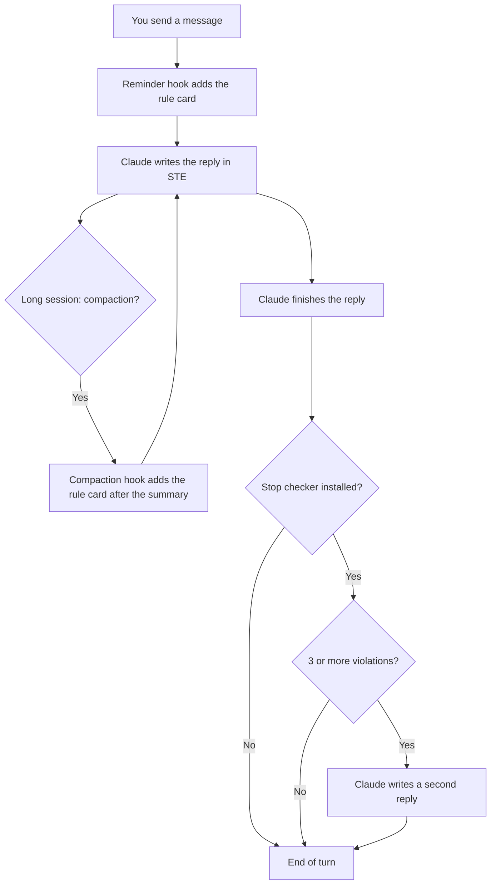

# ASD-STE100 Hooks for Claude Code

In long sessions, Claude Code forgets the instruction to write in Simplified Technical English (STE).
These hooks give Claude the STE rules again with each message and after each compaction.
They do not call a model and do not add a turn.

**Install with an AI agent.** Give your agent this text:

> Set up https://github.com/oiegorov-embrace/claude-ste100-hooks for me. Follow its AGENTS.md.

**Install yourself.** Type these commands in a terminal:

```bash
claude plugin marketplace add oiegorov-embrace/claude-ste100-hooks
claude plugin install ste100-hooks@ste100 --scope user
```

Use `--scope project` in a project folder to share the hooks with your team.
Start a new session after the installation.

| Plugin | What it does | Cost |
| --- | --- | --- |
| `ste100-hooks` (recommended) | Adds the STE rule card to each message and after each compaction | Approximately 150 tokens for each message |
| `ste100-stop-script` (optional) | After each reply, a script examines the reply. Many violations make Claude write the reply again. | **High:** a full second reply |
| `ste100-stop-llm` (optional) | After each reply, Haiku examines the reply. Clear violations make Claude write the reply again. | **Highest:** a Haiku call after each reply, plus a full second reply |

The full instruction follows.

---

> **Language:** This document uses ASD-STE100 Simplified Technical English.
> The files in the `plugins/` folder are in normal English. Claude reads those files, not people.
> Code, commands and file contents stay as they are.

**Applicability:** Claude Code CLI and the Code tab of the Claude desktop app, on macOS or Linux.
**Status:** The system was tested on 2026-10-15 with Claude Code 2.1.300. The reminder hook and the two Stop checkers were tested in real sessions (section 6). The plugin installation was tested from a local copy of this repository. The compaction hook was tested with sample input only.

---

## 1. Purpose

### 1.1 The problem

Your team tells Claude to write in ASD-STE100 Simplified Technical English (STE).
The instruction is in a skill. In a short session, Claude obeys the instruction.
In a long session, Claude starts to write normal English again.

There are two causes:

- Claude reads a skill one time, when the skill starts. In a long session, that text moves far back in the context.
- Compaction makes a summary of old messages. The summary can lose the skill text.

### 1.2 The solution

Hooks put the STE rules in front of Claude again at fixed points:

1. **Reminder hook (`UserPromptSubmit`).** This is the primary solution. It adds a short STE rule card to each message that you send.
2. **Compaction hook (`SessionStart`, matcher `compact`).** This is the companion. It adds the rule card again after each compaction.
3. **Stop hook (optional).** Use it only if Claude still breaks the rules. It examines each reply. If the reply breaks the rules, Claude must write the reply again.

### 1.3 Benefits

- The rule card is always the most recent instruction. A long context cannot hide it.
- Hooks 1 and 2 do not call a model. They do not add a turn. They do not make you wait.
- The team gets the same rules from one plugin.
- You can change the rules for one project with one file: `.claude/ste100-rules.txt`.

---

## 2. Components

| Component | Plugin | Hook event | When it operates | What it does | Cost |
| --- | --- | --- | --- | --- | --- |
| Reminder hook | `ste100-hooks` | `UserPromptSubmit` | Each message that you send | Adds the rule card to the message | Approximately 150 tokens for each message. No model call. |
| Compaction hook | `ste100-hooks` | `SessionStart`, matcher `compact` | After each compaction | Adds the rule card after the summary | Free: approximately 150 tokens, only after a compaction |
| Stop checker, script variant | `ste100-stop-script` | `Stop`, `type: "command"` | After each reply | Counts words and sentences. Finds forbidden words. | **High:** a full second reply when it finds 3 or more violations |
| Stop checker, LLM variant | `ste100-stop-llm` | `Stop`, `type: "prompt"` | After each reply | Haiku examines the grammar rules | **Highest:** one Haiku call after each reply, plus a full second reply when it finds violations |

---

## 3. File hierarchy

This repository is a Claude Code plugin marketplace with the name `ste100`. It has three plugins.

```text
claude-ste100-hooks/
├── README.md                              This instruction
├── AGENTS.md                              Installation procedure for AI agents
├── install.sh                             Manual installer, if you cannot use plugins (section 7.4)
├── .claude-plugin/
│   └── marketplace.json                   The list of the three plugins (section 4.1)
└── plugins/
    ├── ste100-hooks/                      Recommended plugin
    │   ├── .claude-plugin/plugin.json
    │   ├── hooks/hooks.json               Reminder hook and compaction hook (section 4.2)
    │   └── scripts/
    │       ├── ste100-reminder.sh         Script for the two hooks (section 4.3)
    │       └── ste100-rules.txt           Default STE rule card (section 4.4)
    ├── ste100-stop-script/                Optional plugin
    │   ├── .claude-plugin/plugin.json
    │   ├── hooks/hooks.json               Stop hook, script variant
    │   └── scripts/
    │       ├── ste100-stop-check.py       Stop checker script (section 4.5)
    │       └── ste100-forbidden-words.txt Default word list (section 4.6)
    └── ste100-stop-llm/                   Optional plugin
        ├── .claude-plugin/plugin.json
        └── hooks/hooks.json               Stop hook, LLM variant (section 4.7)
```

---

## 4. Files

### 4.1 `.claude-plugin/marketplace.json`

This file makes the repository a plugin marketplace. It gives the name and the folder of each plugin.

**File:** [`.claude-plugin/marketplace.json`](.claude-plugin/marketplace.json)

### 4.2 `plugins/ste100-hooks/hooks/hooks.json`

This file registers the reminder hook and the compaction hook. Both hooks use the same script.

**File:** [`plugins/ste100-hooks/hooks/hooks.json`](plugins/ste100-hooks/hooks/hooks.json)

### 4.3 `plugins/ste100-hooks/scripts/ste100-reminder.sh`

This script reads the hook input. It sends the rule card back as `additionalContext`.
It does not call a model. It does not block a message.
It uses the first rule card that it finds in this sequence:

1. `<project>/.claude/ste100-rules.txt`: the card for one project. Commit it for the team.
2. `~/.claude/ste100-rules.txt`: your personal card.
3. `ste100-rules.txt` in the plugin: the default card.

**File:** [`plugins/ste100-hooks/scripts/ste100-reminder.sh`](plugins/ste100-hooks/scripts/ste100-reminder.sh)

### 4.4 `plugins/ste100-hooks/scripts/ste100-rules.txt`

This is the default rule card. Claude gets this text with each message and after each compaction.
Keep a card short. Each line goes into the context one time for each message.

**File:** [`plugins/ste100-hooks/scripts/ste100-rules.txt`](plugins/ste100-hooks/scripts/ste100-rules.txt)

### 4.5 `plugins/ste100-stop-script/scripts/ste100-stop-check.py` (optional)

This script examines the last reply of Claude. It does not call a model. It finds:

- sentences with more than 25 words;
- paragraphs with more than 6 sentences;
- words from the forbidden-word list.

The script does not examine code blocks, inline code, URLs, headings or tables.
If it finds 3 or more violations, it stops the end of the turn. Claude then writes the reply again.
On the second reply, the script always lets Claude stop. Thus, it cannot make a loop.

**File:** [`plugins/ste100-stop-script/scripts/ste100-stop-check.py`](plugins/ste100-stop-script/scripts/ste100-stop-check.py)

### 4.6 `plugins/ste100-stop-script/scripts/ste100-forbidden-words.txt` (optional)

This is a starter list of forbidden words with their replacements. Each line has the format `forbidden -> replacement`.
To use your own list, put it in `<project>/.claude/ste100-forbidden-words.txt` or `~/.claude/ste100-forbidden-words.txt`.

**CAUTION:** This list is not the ASD-STE100 dictionary. ASD owns the copyright of the dictionary. Get written permission from ASD before you copy the dictionary into a tool.

**File:** [`plugins/ste100-stop-script/scripts/ste100-forbidden-words.txt`](plugins/ste100-stop-script/scripts/ste100-forbidden-words.txt)

### 4.7 `plugins/ste100-stop-llm/hooks/hooks.json` (optional)

This file registers the LLM variant of the Stop checker. A Haiku model examines the reply.
This variant can find grammar problems that a script cannot find, for example passive voice and idioms.
It adds a model call after each reply, also after replies that are correct.

**File:** [`plugins/ste100-stop-llm/hooks/hooks.json`](plugins/ste100-stop-llm/hooks/hooks.json)

---

## 5. How the system works

### 5.1 Overview



### 5.2 Sequence for each message

1. You send a message.
2. The reminder hook finds the rule card (section 4.3).
3. The hook adds the rule card to your message. Only Claude sees the card.
4. Claude writes the reply. The rule card is the most recent instruction.

### 5.3 Sequence after a compaction

1. The context becomes full. Claude Code makes a summary of the old messages.
2. The session starts again with the summary. The `SessionStart` event has the source `compact`.
3. The compaction hook adds the rule card after the summary.
4. Claude continues with the STE rules, also before your next message.

### 5.4 Sequence of the Stop checker (optional)

1. Claude finishes the reply. The Stop hook starts.
2. The checker examines the reply.
3. If the reply has fewer than 3 violations, the turn ends.
4. If the reply has 3 or more violations, the hook sends the list of violations to Claude.
5. Claude writes a full second reply. You see the two replies.
6. On the second reply, the hook lets the turn end.

---

## 6. Cost of each solution

**WARNING:** The Stop hook is the most expensive solution. It cannot change a reply that you already see. It can only make Claude write a full second reply. You pay for the two replies, and you read the two replies.

We did one test run for each configuration on 2026-10-15. The test used `claude -p` with Sonnet 5.5 and one short question. The costs include all hooks of the test computer.

| Configuration | Turns | Cost (USD) | Time | Result |
| --- | --- | --- | --- | --- |
| No hooks | 1 | 0.049 | 5.8 s | Normal English. Longest sentence: 39 words. |
| Reminder hook | 1 | 0.057 | 11.1 s | STE. Longest sentence: 17 words. Paragraphs: 6 and 6 sentences. |
| Stop checker, script variant | 2 | 0.088 | 13.3 s | Second reply. Longest sentence: 23 words. Paragraphs: 6 and 10 sentences. |
| Stop checker, LLM variant | 2 | 0.090 | 20.8 s | Second reply. Longest sentence: 25 words. Paragraphs: 8 and 10 sentences. |

**NOTE:** One run for each configuration is a small sample. Times change from run to run. The result is clear: the reminder hook gave the best STE text at the lowest cost.

Cost of each hook in a long session:

- **Reminder hook:** approximately 150 tokens for each message. The tokens stay in the context. After 100 messages, they are approximately 15,000 tokens. Prompt caching makes repeated tokens cheap.
- **Compaction hook:** free in practice. It operates only after a compaction. It adds approximately 150 tokens one time.
- **Stop checker:** when it blocks, a full second reply. That is approximately two times the cost of the reply. The LLM variant also adds one Haiku call after each reply. In the test, the LLM variant took 7.5 seconds more than the script variant.

---

## 7. Installation procedure

### 7.1 Make sure that the prerequisites are available

1. Make sure that Claude Code is installed. Type `claude --version`.
2. Make sure that `jq` 1.6 or higher is installed. Type `jq --version`.
3. If you install `ste100-stop-script`, make sure that Python 3 is installed. Type `python3 --version`.

### 7.2 Select the scope

| Scope | Command option | Effect |
| --- | --- | --- |
| User | `--scope user` | The STE rules apply in all your projects. Only you get them. |
| Project | `--scope project` | The STE rules apply in one project. The team gets them through `.claude/settings.json`. |

### 7.3 Install the plugin

1. For the project scope, go to the project folder first.
2. Add the marketplace. Use the scope from section 7.2:

```bash
claude plugin marketplace add oiegorov-embrace/claude-ste100-hooks --scope user
```

3. Install the recommended plugin:

```bash
claude plugin install ste100-hooks@ste100 --scope user
```

4. For the project scope, commit `.claude/settings.json`. Each team member gets the plugin after they trust the project folder.
5. Start a new session.

**CAUTION:** Install the Stop checker only if Claude still breaks the rules with `ste100-hooks`. Install only one variant:

```bash
claude plugin install ste100-stop-script@ste100 --scope user
```

### 7.4 Install without plugins

Use this procedure only if your organization does not let you install plugins.

1. Get the files:

```bash
git clone https://github.com/oiegorov-embrace/claude-ste100-hooks.git
cd claude-ste100-hooks
```

2. Run the installer. Change `<project>` to the path of your project:

```bash
./install.sh --scope project --project-dir <project>
```

**NOTE:** The installer makes a backup of `settings.json`. It keeps your other hooks. You can run it again. It does not make duplicate hooks. Type `./install.sh --help` for all options.

---

## 8. Test procedure

### 8.1 Make sure that the plugin is enabled

1. Type this command:

```bash
claude plugin list
```

2. Make sure that `ste100-hooks@ste100` shows `Status: ✔ enabled`.

**NOTE:** For the project scope, do test 8.2 in the project folder. Then remove the test card from `.claude/ste100-rules.txt`.

### 8.2 Make sure that the hook operates

1. Make a test folder with a test rule card:

```bash
mkdir -p /tmp/ste100-test/.claude && cd /tmp/ste100-test
echo "Test marker: end your reply with the exact word PINEAPPLE on its own line." > .claude/ste100-rules.txt
```

2. Ask Claude a question in that folder:

```bash
claude -p "What is 2+2? One line."
```

3. Make sure that the reply ends with `PINEAPPLE`.
4. Remove the test folder:

```bash
cd ~ && rm -r /tmp/ste100-test
```

### 8.3 Test in a real session

1. Start Claude Code in a project folder.
2. Ask a question that needs a long answer.
3. Make sure that the reply has short sentences and active voice.

---

## 9. Settings and maintenance

| Setting | Where | Default | Effect |
| --- | --- | --- | --- |
| Rule card | `<project>/.claude/ste100-rules.txt` or `~/.claude/ste100-rules.txt` | The card in the plugin | The text that Claude gets |
| Forbidden words | `<project>/.claude/ste100-forbidden-words.txt` or `~/.claude/ste100-forbidden-words.txt` | The list in the plugin | Stop checker: words to replace |
| `STE100_MAX_WORDS` | Environment variable | `25` | Stop checker: maximum words in a sentence |
| `STE100_MAX_SENTENCES` | Environment variable | `6` | Stop checker: maximum sentences in a paragraph |
| `STE100_MIN_VIOLATIONS` | Environment variable | `3` | Stop checker: number of violations that starts a rewrite |

### 9.1 Change the rules

1. Copy the default card to `<project>/.claude/ste100-rules.txt`.
2. Edit the copy. Keep it short. Each line costs tokens on each message.
3. Commit the change. The next message uses the new card. You do not restart Claude Code.

### 9.2 Update the plugins

1. Type this command:

```bash
claude plugin update ste100-hooks@ste100
```

**NOTE:** The plugins have no fixed version. Each update gets the latest commit of this repository.

### 9.3 Remove the plugins

1. Type this command. Use the same scope as the installation:

```bash
claude plugin uninstall ste100-hooks@ste100 --scope user
```

2. If you used `install.sh`, type `./install.sh --scope <scope> --uninstall` with the same options.

---

## 10. Troubleshooting

| Symptom | Possible cause | Action |
| --- | --- | --- |
| Claude writes normal English from the first message | The plugin is not enabled | Do test 8.1. In a session, type `/plugin` and examine the **Errors** tab. |
| `jq: error: --rawfile` | `jq` is older than 1.6 | Install a newer `jq`. |
| The rule card comes two times | The plugin and `install.sh` are both installed | Remove one of them (section 9.3). |
| The hooks do not operate for a team member | The person does not trust the project folder, or has old project files | Pull the project. Start Claude Code in the project folder and trust the folder. |
| `marketplace add` or `/plugin install` fails with a git error | The computer has no GitHub SSH key | Set `CLAUDE_CODE_PLUGIN_PREFER_HTTPS=1`, then try again. |
| Each reply comes two times | The Stop checker blocks too often | Set `STE100_MIN_VIOLATIONS` to a higher value, or remove the Stop checker. |
| The second reply also breaks the rules | The Stop checker lets Claude stop after one rewrite. This prevents a loop. | Make the rule card more clear. The Stop checker does not try again. |

---

## 11. The ASD-STE100 specification

The ASD-STE100 specification and its dictionary are free of charge. Request a copy at [asd-ste100.org](https://www.asd-ste100.org/).
ASD owns the copyright and the trademark. A free copy does not give permission to put the dictionary into a software tool.
