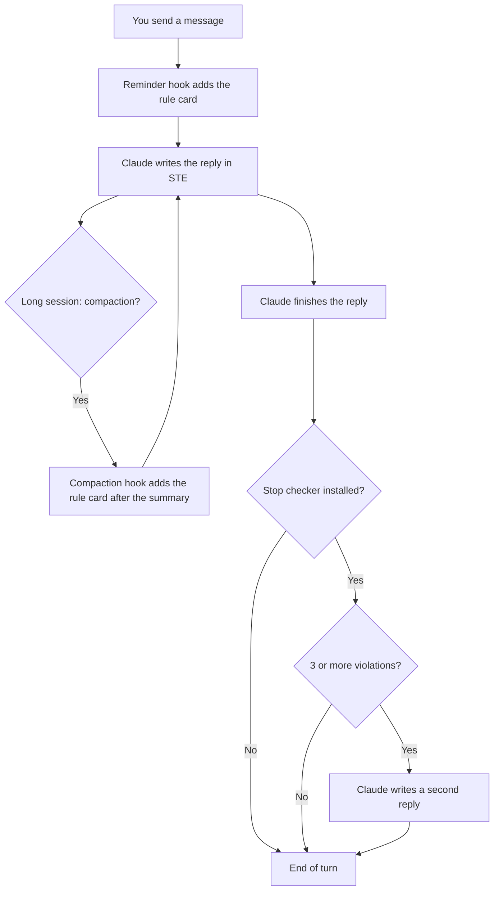

# ASD-STE100 Hooks for Claude Code: Setup Instruction

> **Language:** This document uses ASD-STE100 Simplified Technical English.
> The files in the `dot-claude/` folder are in normal English. Claude reads those files, not people.
> Code, commands and file contents stay as they are.

**Applicability:** Claude Code CLI and the Code tab of the Claude desktop app, on macOS or Linux.
**Status:** The system was tested on 2026-10-15 with Claude Code 2.1.300. The reminder hook and the two Stop checkers were tested in real sessions (section 6). The compaction hook was tested with sample input only.

---

## 1. Purpose

### 1.1 The problem

Your team tells Claude to write in ASD-STE100 Simplified Technical English (STE).
The instruction is in a skill. In a short session, Claude obeys the instruction.
In a long session, Claude starts to write normal English again.

There are two causes:

- Claude reads a skill one time, when the skill starts. In a long session, that text moves far back in the context.
- Compaction makes a summary of old messages. The summary can lose the skill text.

### 1.2 The solution

Hooks put the STE rules in front of Claude again at fixed points:

1. **Reminder hook (`UserPromptSubmit`).** This is the primary solution. It adds a short STE rule card to each message that you send.
2. **Compaction hook (`SessionStart`, matcher `compact`).** This is the companion. It adds the rule card again after each compaction.
3. **Stop hook (optional).** Use it only if Claude still breaks the rules. It examines each reply. If the reply breaks the rules, Claude must write the reply again.

### 1.3 Benefits

- The rule card is always the most recent instruction. A long context cannot hide it.
- Hooks 1 and 2 do not call a model. They do not add a turn. They do not make you wait.
- The team gets the same rules from one file in the project repository.
- You change the rules in one file: `ste100-rules.txt`.

---

## 2. Components

| Component | Hook event | When it operates | What it does | Cost |
| --- | --- | --- | --- | --- |
| Reminder hook | `UserPromptSubmit` | Each message that you send | Adds the rule card to the message | Approximately 150 tokens for each message. No model call. |
| Compaction hook | `SessionStart`, matcher `compact` | After each compaction | Adds the rule card after the summary | Free: approximately 150 tokens, only after a compaction |
| Stop checker, script variant (optional) | `Stop`, `type: "command"` | After each reply | Counts words and sentences. Finds forbidden words. | **High:** a full second reply when it finds 3 or more violations |
| Stop checker, LLM variant (optional) | `Stop`, `type: "prompt"` | After each reply | Haiku examines the grammar rules | **Highest:** one Haiku call after each reply, plus a full second reply when it finds violations |

---

## 3. File hierarchy

This repository has a `dot-claude/` folder. Its structure agrees with the `.claude/` folder of your project.

```text
claude-ste100-hooks/
├── README.md                           This instruction
└── dot-claude/                         Copy of the files for <project>/.claude/
    ├── settings.json                   Reminder hook and compaction hook (section 4.1)
    ├── settings.stop-script.json       Stop checker, script variant, optional (section 4.5)
    ├── settings.stop-llm.json          Stop checker, LLM variant, optional (section 4.7)
    └── hooks/
        ├── ste100-rules.txt            The STE rule card (section 4.2)
        ├── ste100-reminder.sh          Script for the reminder and compaction hooks (section 4.3)
        ├── ste100-stop-check.py        Script for the Stop checker (section 4.4)
        └── ste100-forbidden-words.txt  Word list for the Stop checker (section 4.6)
```

---

## 4. Files

Each file is in the `dot-claude/` folder of this repository.

### 4.1 `settings.json`

This file registers the reminder hook and the compaction hook.
Both hooks use the same script.

**File:** [`dot-claude/settings.json`](dot-claude/settings.json)

### 4.2 `hooks/ste100-rules.txt`

This is the rule card. Claude gets this text with each message and after each compaction.
Keep the card short. Each line goes into the context one time for each message.

**File:** [`dot-claude/hooks/ste100-rules.txt`](dot-claude/hooks/ste100-rules.txt)

### 4.3 `hooks/ste100-reminder.sh`

This script reads the hook input. It sends the rule card back as `additionalContext`.
It does not call a model. It does not block a message.

**File:** [`dot-claude/hooks/ste100-reminder.sh`](dot-claude/hooks/ste100-reminder.sh)

### 4.4 `hooks/ste100-stop-check.py` (optional)

This script examines the last reply of Claude. It does not call a model. It finds:

- sentences with more than 25 words;
- paragraphs with more than 6 sentences;
- words from `ste100-forbidden-words.txt`.

The script does not examine code blocks, inline code, URLs, headings or tables.
If it finds 3 or more violations, it stops the end of the turn. Claude then writes the reply again.
On the second reply, the script always lets Claude stop. Thus, it cannot make a loop.

**File:** [`dot-claude/hooks/ste100-stop-check.py`](dot-claude/hooks/ste100-stop-check.py)

### 4.5 `settings.stop-script.json` (optional)

This file registers the script variant of the Stop checker.

**File:** [`dot-claude/settings.stop-script.json`](dot-claude/settings.stop-script.json)

### 4.6 `hooks/ste100-forbidden-words.txt` (optional)

This is a starter list of forbidden words with their replacements. Each line has the format `forbidden -> replacement`.

**CAUTION:** This list is not the ASD-STE100 dictionary. ASD owns the copyright of the dictionary. Get written permission from ASD before you copy the dictionary into a tool.

**File:** [`dot-claude/hooks/ste100-forbidden-words.txt`](dot-claude/hooks/ste100-forbidden-words.txt)

### 4.7 `settings.stop-llm.json` (optional)

This file registers the LLM variant of the Stop checker. A Haiku model examines the reply.
This variant can find grammar problems that a script cannot find, for example passive voice and idioms.
It adds a model call after each reply, also after replies that are correct.

**File:** [`dot-claude/settings.stop-llm.json`](dot-claude/settings.stop-llm.json)

---

## 5. How the system works

### 5.1 Overview



### 5.2 Sequence for each message

1. You send a message.
2. The reminder hook reads `ste100-rules.txt`.
3. The hook adds the rule card to your message. Only Claude sees the card.
4. Claude writes the reply. The rule card is the most recent instruction.

### 5.3 Sequence after a compaction

1. The context becomes full. Claude Code makes a summary of the old messages.
2. The session starts again with the summary. The `SessionStart` event has the source `compact`.
3. The compaction hook adds the rule card after the summary.
4. Claude continues with the STE rules, also before your next message.

### 5.4 Sequence of the Stop checker (optional)

1. Claude finishes the reply. The Stop hook starts.
2. The checker examines the reply.
3. If the reply has fewer than 3 violations, the turn ends.
4. If the reply has 3 or more violations, the hook sends the list of violations to Claude.
5. Claude writes a full second reply. You see the two replies.
6. On the second reply, the hook lets the turn end.

---

## 6. Cost of each solution

**WARNING:** The Stop hook is the most expensive solution. It cannot change a reply that you already see. It can only make Claude write a full second reply. You pay for the two replies, and you read the two replies.

We did one test run for each configuration on 2026-10-15. The test used `claude -p` with Sonnet 5.5 and one short question. The costs include all hooks of the test computer.

| Configuration | Turns | Cost (USD) | Time | Result |
| --- | --- | --- | --- | --- |
| No hooks | 1 | 0.049 | 5.8 s | Normal English. Longest sentence: 39 words. |
| Reminder hook | 1 | 0.057 | 11.1 s | STE. Longest sentence: 17 words. Paragraphs: 6 and 6 sentences. |
| Stop checker, script variant | 2 | 0.088 | 13.3 s | Second reply. Longest sentence: 23 words. Paragraphs: 6 and 10 sentences. |
| Stop checker, LLM variant | 2 | 0.090 | 20.8 s | Second reply. Longest sentence: 25 words. Paragraphs: 8 and 10 sentences. |

**NOTE:** One run for each configuration is a small sample. Times change from run to run. The result is clear: the reminder hook gave the best STE text at the lowest cost.

Cost of each hook in a long session:

- **Reminder hook:** approximately 150 tokens for each message. The tokens stay in the context. After 100 messages, they are approximately 15,000 tokens. Prompt caching makes repeated tokens cheap.
- **Compaction hook:** free in practice. It operates only after a compaction. It adds approximately 150 tokens one time.
- **Stop checker:** when it blocks, a full second reply. That is approximately two times the cost of the reply. The LLM variant also adds one Haiku call after each reply. In the test, the LLM variant took 7.5 seconds more than the script variant.

---

## 7. Installation procedure

### 7.1 Make sure that the prerequisites are available

1. Make sure that Claude Code is installed. Type `claude --version`.
2. Make sure that `jq` 1.6 or higher is installed. Type `jq --version`.
3. If you install the script variant of the Stop checker, make sure that Python 3 is installed. Type `python3 --version`.

### 7.2 Get the files

1. Type these commands:

```bash
git clone https://github.com/oiegorov-embrace/claude-ste100-hooks.git
cd claude-ste100-hooks/dot-claude
```

### 7.3 Install for a team project (recommended)

The hooks then operate for each person who works in the project.

1. Set the project folder. Change `<project>` to the path of your project:

```bash
P=<project>
```

2. Copy the hook scripts:

```bash
mkdir -p "$P/.claude/hooks"
cp hooks/ste100-rules.txt hooks/ste100-reminder.sh "$P/.claude/hooks/"
chmod +x "$P/.claude/hooks/ste100-reminder.sh"
```

3. If the project has no `.claude/settings.json`, copy the file:

```bash
cp -n settings.json "$P/.claude/settings.json"
```

4. If the project has a `.claude/settings.json`, merge the `hooks` key into it:

```bash
cp "$P/.claude/settings.json" "$P/.claude/settings.json.bak"
jq -s '.[0] as $a | .[1] as $b | $a + {hooks: (reduce ($b.hooks | to_entries[]) as $e (($a.hooks // {}); .[$e.key] = ((.[$e.key] // []) + $e.value)))}' "$P/.claude/settings.json.bak" settings.json > "$P/.claude/settings.json"
jq empty "$P/.claude/settings.json" && echo valid
```

5. Commit the files in the project repository. Then the team gets the hooks with the next pull.

**NOTE:** The merge command keeps your other settings and hooks. It adds the new hooks after your current hooks.

### 7.4 Install for one person only

1. Copy the hook scripts to your user folder:

```bash
mkdir -p ~/.claude/hooks
cp hooks/ste100-rules.txt hooks/ste100-reminder.sh ~/.claude/hooks/
chmod +x ~/.claude/hooks/ste100-reminder.sh
```

2. Make a backup copy of your settings:

```bash
cp ~/.claude/settings.json ~/.claude/settings.json.bak
```

3. Add the hooks from `settings.json` to `~/.claude/settings.json`. Change each path `"$CLAUDE_PROJECT_DIR"/.claude/hooks/` to `~/.claude/hooks/`.
4. Make sure that the file is valid JSON:

```bash
jq empty ~/.claude/settings.json && echo valid
```

**CAUTION:** With this installation, the STE rules apply in all your projects.

### 7.5 Install the Stop checker (optional)

**CAUTION:** Install the Stop checker only if Claude still breaks the rules with the reminder hook. The Stop checker is the most expensive solution (section 6).

1. Select one variant: the script variant or the LLM variant. Do not install the two variants together.
2. For the script variant, copy the script and the word list:

```bash
cp hooks/ste100-stop-check.py hooks/ste100-forbidden-words.txt "$P/.claude/hooks/"
chmod +x "$P/.claude/hooks/ste100-stop-check.py"
```

3. Add the `Stop` key from `settings.stop-script.json` or `settings.stop-llm.json` to `"$P/.claude/settings.json"`.
4. Make sure that the file is valid JSON:

```bash
jq empty "$P/.claude/settings.json" && echo valid
```

---

## 8. Test procedure

### 8.1 Test the reminder script

1. Type this command in the project folder:

```bash
echo '{"hook_event_name":"UserPromptSubmit"}' | .claude/hooks/ste100-reminder.sh | jq .
```

2. Make sure that `additionalContext` has the text of the rule card.

### 8.2 Test the compaction hook

1. Type this command:

```bash
echo '{"hook_event_name":"SessionStart","source":"compact"}' | .claude/hooks/ste100-reminder.sh | jq -r .hookSpecificOutput.hookEventName
```

2. Make sure that the output is `SessionStart`.

### 8.3 Test the Stop checker (optional)

1. Type this command:

```bash
jq -n '{stop_hook_active:false,last_assistant_message:"In order to leverage the cache, you should ensure that the configuration file which is located in the project directory has been updated by the person who maintains the build."}' | .claude/hooks/ste100-stop-check.py | jq -r .reason
```

2. Make sure that the output shows 4 violations.

### 8.4 Test in a real session

1. Start Claude Code in the project folder.
2. Ask a question that needs a long answer.
3. Make sure that the reply has short sentences and active voice.

---

## 9. Settings and maintenance

| Setting | Where | Default | Effect |
| --- | --- | --- | --- |
| Rule card | `.claude/hooks/ste100-rules.txt` | 8 rules | The text that Claude gets |
| `STE100_MAX_WORDS` | Environment variable | `25` | Stop checker: maximum words in a sentence |
| `STE100_MAX_SENTENCES` | Environment variable | `6` | Stop checker: maximum sentences in a paragraph |
| `STE100_MIN_VIOLATIONS` | Environment variable | `3` | Stop checker: number of violations that starts a rewrite |
| Forbidden words | `.claude/hooks/ste100-forbidden-words.txt` | 12 words | Stop checker: words to replace |
| Model of the LLM variant | `model` in `settings.stop-llm.json` | `claude-haiku-5-5` | A larger model finds more problems. It costs more and is slower. |

### 9.1 Change the rules

1. Edit `ste100-rules.txt`.
2. Keep the card short. Each line costs tokens on each message.
3. Commit the change. The next message uses the new card. You do not restart Claude Code.

### 9.2 Stop the system

1. Remove the `UserPromptSubmit` entry and the `SessionStart` entry from `.claude/settings.json`.
2. Remove the `Stop` entry, if you installed the Stop checker.

---

## 10. Troubleshooting

| Symptom | Possible cause | Action |
| --- | --- | --- |
| Claude writes normal English from the first message | The hook did not start | In the Claude Code CLI, type `/hooks`. Make sure that the hooks are in the list. Then do test 8.1. |
| `jq: error: --rawfile` | `jq` is older than 1.6 | Install a newer `jq`. |
| `Permission denied` in the hook output | The script is not executable | Type `chmod +x .claude/hooks/*.sh .claude/hooks/*.py`. |
| The hooks do not operate for a team member | The person does not have the latest project files | Pull the project repository. Make sure that `.claude/hooks/ste100-reminder.sh` is executable. |
| Each reply comes two times | The Stop checker blocks too often | Set `STE100_MIN_VIOLATIONS` to a higher value, or remove the Stop checker. |
| The second reply also breaks the rules | The Stop checker lets Claude stop after one rewrite. This prevents a loop. | Make the rule card more clear. The Stop checker does not try again. |

---

## 11. The ASD-STE100 specification

The ASD-STE100 specification and its dictionary are free of charge. Request a copy at [asd-ste100.org](https://www.asd-ste100.org/).
ASD owns the copyright and the trademark. A free copy does not give permission to put the dictionary into a software tool.
